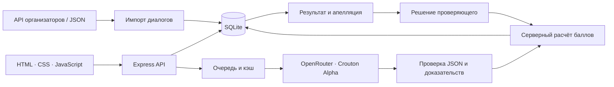

<div align="center">

# Tumo · Conversation Quality Analytics

**От диалога — к понятной оценке с доказательствами**

Прототип для хакатона **Freedom Broker** · Команда **Tumo**


[Быстрый старт](#быстрый-старт) · [Возможности](#возможности) · [Как это работает](#как-это-работает) · [Проверки](#проверки-и-результаты) · [Документация](#документация)

</div>

---

Tumo-CQA помогает проверить, как оператор общается с клиентом. Сервис загружает диалоги, оценивает их по выбранной версии чек-листа и показывает объяснения со ссылками на реплики. Спорную оценку можно обжаловать: решение проверяющего пересчитает итог, сохранив исходный результат.

> **ИИ анализирует разговор. Сервер считает баллы. Человек принимает решение по апелляции.**
>
> Рабочая ветка проекта — **`backend`**. Для запуска используйте команду клонирования ниже.

## Возможности

| Задача | Что делает сервис |
|:--|:--|
| **Загрузка диалогов** | Получает набор через GET API организаторов по `group_id` или импортирует JSON. Сохраняет роли, исходное время и ссылки на записи. |
| **Чек-листы и версии** | Начальная конфигурация содержит 8 критериев. Можно менять формулировки, веса, шкалы и N/A; сохранение создаёт отдельную версию. |
| **Оценка через ИИ** | Передаёт транскрипт и выбранные критерии модели через OpenRouter. Поддерживает диалоги RU, KZ и EN. |
| **Доказательства** | Показывает объяснение, номера реплик и проверенный участок при пропущенном действии. Клик выделяет фрагмент транскрипта. |
| **Расчёт баллов** | Учитывает шкалы, веса и N/A, рассчитывает секции и итог. Грубая ошибка отмечается отдельно. |
| **Пакетная обработка** | Оценивает группу, показывает прогресс и ошибки отдельных заданий. |
| **Кэш** | Повторно использует ответ для совпадающих данных, правил, модели и версии промпта. |
| **Апелляции** | Сохраняет комментарий, решение и причину; показывает исходный и финальный итог. |
| **Экспорт** | Выгружает CSV и JSON для сдачи по приложению к заданию. |

В интерфейсе — боковая навигация, карточка диалога в модальном окне, аудиоплеер для звонков и редактор одного выбранного чек-листа с раскрывающимися критериями.

## Быстрый старт

Понадобятся **Git** и **Node.js 24+**. Отдельно устанавливать базу данных или собирать фронтенд не нужно.

```bash
git clone --branch backend https://github.com/amirlan-io/Tumo-CQA.git
cd Tumo-CQA
npm ci
```

Создайте локальный файл настроек. В **PowerShell**:

```powershell
Copy-Item .env.example .env
```

В **macOS / Linux**:

```bash
cp .env.example .env
```

Запустите сервер:

```bash
npm start
```

| Адрес | Назначение |
|:--|:--|
| [127.0.0.1:3000/frontend/](http://127.0.0.1:3000/frontend/) | Интерфейс приложения |
| [127.0.0.1:3000/api/health](http://127.0.0.1:3000/api/health) | Проверка сервера: `{"status":"ok"}` |

SQLite создаётся автоматически в `data/cqa.sqlite`. Сервер по умолчанию слушает только `127.0.0.1`.

### Настройка настоящей оценки

Заполните **локальный `.env`**:

```dotenv
AI_ENABLED=true
AI_API_KEY=YOUR_OPENROUTER_API_KEY
AI_BASE_URL=https://openrouter.ai/api/v1
AI_MODEL=stealth/crouton-alpha
ORGANIZER_API_URL=YOUR_ORGANIZER_GET_URL
```

- `AI_API_KEY` — ключ провайдера; хранится на сервере.
- `ORGANIZER_API_URL` — полный адрес кнопки GET из материалов организаторов. Контрольный `group_id` вводится в интерфейсе.
- После изменения настроек перезапустите сервер.
- При `AI_ENABLED=false` настоящая оценка отключена: интерфейс сообщает об этом. Демонстрационные ответы доступны отдельно и явно подписаны.

**Не публикуйте `.env`, базу и диагностику.** Они исключены из Git. `.env.example` содержит только шаблон настроек.

## Сценарий работы

1. **Загрузите группу.** В разделе «Диалоги» введите `DEV` и нажмите «Загрузить группу». Эта кнопка импортирует данные; оценка запускается отдельно.
2. **Откройте диалог.** Просмотрите реплики; для звонка доступна запись.
3. **Выберите версию чек-листа.** Нажмите «Оценить через ИИ» и дождитесь завершения задания.
4. **Проверьте результат.** Посмотрите ответы, баллы, причины N/A и доказательства. Для всей группы используйте пакетный запуск.
5. **Оспорьте критерий.** Добавьте комментарий и подайте апелляцию.
6. **Примите решение.** В разделе «Апелляции» подтвердите или измените ответ с причиной. Итог пересчитается, история сохранится.
7. **Измените правила при необходимости.** В «Чек-листах» отредактируйте выбранный критерий и сохраните новую версию. Старые оценки останутся связаны со своими правилами.

<details>
<summary><strong>Проверить интерфейс без ключа модели</strong></summary>

В «Диалогах» нажмите «Загрузить вымышленный диалог», откройте `DEMO-001` и запустите оценку на вымышленных ответах для начальной версии чек-листа. Затем проверьте доказательства и апелляцию.

Это демонстрация интерфейса и серверного расчёта, **не вызов модели**. Демонстрационная группа не подходит для официальной сдачи.

</details>

## Как это работает



### Модель и проверка ответа

Модуль `server/services/ai.js` отправляет выбранные критерии и транскрипт через API. Текущая конфигурация использует `stealth/crouton-alpha`, версия промпта — `v1`.

Ответ проходит JSON Schema и серверную проверку: значения должны соответствовать шкалам, а номера доказательств — существующим репликам. При некорректном ответе предусмотрен один корректирующий запрос. Формальная проверка не гарантирует смысловую правильность вывода — для этого нужны ручная проверка и апелляции.

Задания проходят состояния:

```text
queued → running → completed
                 ↘ failed
```

Ошибка одного диалога не останавливает весь пакет. Основная очередь последовательная. Кэш учитывает данные диалога, конфигурацию критериев, модель и версию промпта; решения проверяющего не подменяют кэш исходных ответов ИИ.

### Подсчёт и N/A

Для каждого применимого критерия сервер нормализует ответ по его шкале и умножает на вес. Итог:

```text
Итог = 100 × сумма начисленных баллов / сумма применимых весов
```

Результат округляется до двух знаков. Критерии с N/A исключаются из применимых весов. Если применимых весов нет, итог — `null`. Флаг грубой ошибки хранится отдельно и сам по себе не обнуляет балл.

После апелляции исходные ответы сохраняются, а финальный результат рассчитывается с учётом решений проверяющего.

## Экспорт для сдачи

Приложение к заданию предусматривает:

| Набор | Путь | Состав |
|:--|:--|:--|
| DEV | `results/dev/results.json` | 65 диалогов: 60 чатов и 5 звонков |
| Контрольный | `results/prod/results.json` | 10 чатов, группа от организаторов |

При работающем сервере получите UUID исходной версии через `GET /api/checklists`, затем выполните:

```bash
node scripts/export-submission.js --dataset dev --group DEV --version YOUR_VERSION_UUID --model stealth/crouton-alpha
```

Для контрольного набора:

```bash
node scripts/export-submission.js --dataset prod --group YOUR_CONTROL_GROUP --version YOUR_VERSION_UUID --model stealth/crouton-alpha
```

Экспорт использует исходные ответы ИИ, а не решения по апелляциям. Для формата `1.0` требуется исходная рубрика из восьми критериев. Для изменённого чек-листа соответствие официальному формату необходимо согласовать отдельно.

**Проверьте вывод команды:** отсутствие или ошибка оценки отражается как `status: "error"`. Создание файла не означает, что все диалоги успешно оценены. Скрипт не выполняет commit или push: перед сдачей отдельно проверьте наличие файлов в публичной ветке репозитория.

## Проверки и результаты

```bash
npm test
```

Тесты охватывают API, расчёты, N/A, версии, импорт, апелляции, очередь, пакетную обработку, кэш, контракт ИИ, экспорт и сценарии интерфейса через jsdom.

| Проверка | Зафиксированный результат |
|:--|:--|
| Предыдущий полный запуск автотестов | 230 пройдено; актуальное состояние проверяется через `npm test` |
| Настоящая оценка DEV через Crouton Alpha | 65 успешных результатов из 65 |
| Проверка выгрузки DEV | Идентификаторы, типы ответов, границы доказательств и пересчёт итогов |
| Независимая проверка арифметики DEV | Итоги сверены с Python Decimal |
| Проверка кэша на одном RU-диалоге | Первый ответ ≈15,3 с, повтор из кэша ≈5 мс; отдельный локальный эксперимент |

**Успешная обработка не равна точности модели.** Предварительный разбор 9 диалогов дал 56 совпадений из 72 ответов с черновой разметкой. Эта разметка не является утверждённым человеческим эталоном; показатель нельзя представлять как доказанную точность. Подробности и расхождения — в [отчёте проверки ИИ](docs/ai-validation.md).

Проверки jsdom не заменяют визуальную проверку браузера. Разовый полный прогон DEV также не доказывает, что обычный кэш очереди заполнен для всех 65 диалогов.

## Структура проекта

```text
frontend/                 Интерфейс HTML, CSS и JavaScript
server/
  app.js                  HTTP API и выдача фронтенда
  store.js                SQLite и операции с данными
  checklists.js           Критерии и версии
  organizer.js            Подключение API организаторов
  import.js               Импорт и защита от дублей
  jobs.js                 Очередь, пакеты и кэш
  score.js                Расчёт и применение решений
  validate-results.js     Проверка результатов
  submission.js           Официальный JSON-экспорт
  services/               Модуль ИИ и контракт
  prompts/                Промпт оценки
scripts/                  Экспорт и инструменты проверки ИИ
tests/                    Автотесты
docs/                     API, отчёты и инструкции
results/                  Файлы сдачи после экспорта
data/                     Локальная база и диагностика, вне Git
```

## Документация

| Документ | Что внутри |
|:--|:--|
| [API](docs/api.md) | Маршруты, запросы, задания и экспорт |
| [Модуль ИИ](docs/ai.md) | Настройка провайдера и запуск проверки |
| [Проверка качества ИИ](docs/ai-validation.md) | Результаты предварительного разбора и ограничения |
| [Сверка с ТЗ](docs/tz-audit.md) | Требования и границы выполненных проверок |
| [Финальная проверка](docs/final-check.md) | Новые функции и сценарии ручной проверки |
| [Аудит фронтенда](docs/frontend-audit.md) | Зафиксированные проверки интерфейса |

Отчёты описывают состояние на момент их составления; актуальное поведение проверяйте запуском приложения и тестов.

## Границы прототипа

- Регистрация и авторизация отсутствуют по условиям демонстрации. Для публичного рабочего сервиса потребуются контроль доступа и отдельная подготовка.
- Настоящая оценка зависит от доступности внешней модели, сети и лимитов провайдера.
- Повторный импорт существующего `group_id + conversation_id` не обновляет транскрипт.
- Перед уходом из редактора чек-листа сохраните изменения.
- Для звонков доступно воспроизведение фрагмента по меткам транскрипта. Точность зависит от соответствия меток записи; покадровое выравнивание не гарантируется.
- HTML/CSS/JS-интерфейс подготовлен для дальнейшей адаптации под Dynamics 365. Готовая интеграция с Dynamics 365 не заявляется.
- Учебный тренер показывает безопасные речевые шаблоны RU/KZ/EN для проблемных критериев. Это подготовленные шаблоны, а не дополнительная генерация ИИ.

---

<div align="center">

**Tumo · Freedom Broker CQA Hackathon**<br>
Понятные правила. Проверяемые доказательства. История решений.

</div>
